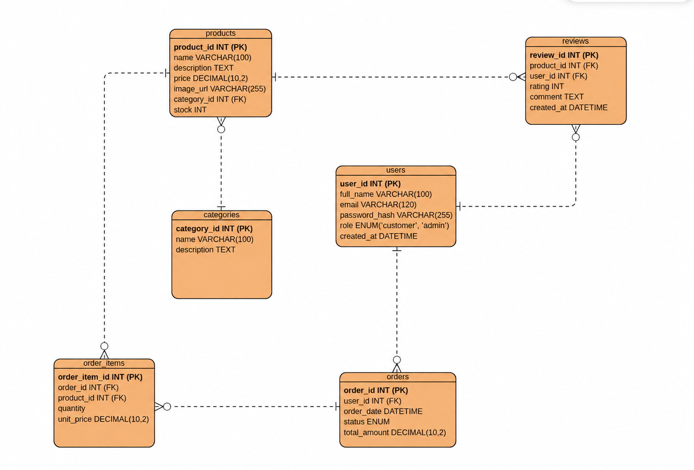

# Aurora Shoes

Aurora Shoes is a single-page web application for an online shoe shop.
It is designed for browsing shoes, categories and reviews,
placing orders and managing customer profiles.

## Milestone 1

- Static frontend pages.
- SPA navigation using jQuery SPApp.
- Responsive design using Bootstrap and custom CSS.
- Separate frontend and backend folders.
- ER diagram with six entities.
- Project and AI usage documentation.

The frontend uses sample data. Forms are not connected to the backend.

## Milestone 2

The local MySQL/MariaDB database contains six tables:
users, categories, products, orders, order_items and reviews.

The schema includes primary keys, foreign keys and constraints.
Sample data for all six tables is included in database/aurora_shoes.sql.
A database export is available in database/aurora_shoes_export.sql.

The PHP backend uses PDO prepared statements, a shared BaseDAO
and a DAO class for each table. The DAO structure was adapted
from the supplied shoe-shop-web-app-main reference project.

Read checks passed using test_daos.php.
Create, read, update and delete checks passed for all six entities
using test_crud.php. The CRUD test rolls back its changes.

The SQL export was successfully imported into a separate test database.

## Relationships and roles

A user can have many orders and reviews.
A category contains products.
Orders contain order items, each linked to a product.
Each review belongs to a user and a product.

Application roles are customer and admin.
Demo users for both roles are included in the database.
Application login is not implemented yet.

## Local setup

1. Start MySQL in XAMPP.
2. Create an empty database named aurora_shoes, select it,
   and import database/aurora_shoes_export.sql.
3. Copy backend/config/config.example.php to backend/config/config.php.
4. Enter your local database credentials in config.php.
   This file is excluded from Git.

Import the export only into a fresh database.
Use an account with permission to create tables and import data.
The account used by PHP needs SELECT, INSERT, UPDATE and DELETE
permissions on aurora_shoes.

Run the checks from the project root:

```powershell
& "C:\xampp\php\php.exe" backend/test_connection.php
& "C:\xampp\php\php.exe" backend/test_daos.php
& "C:\xampp\php\php.exe" backend/test_crud.php
```

## Database diagram



## AI documentation

- AGENTS.md — project architecture and rules.
- docs/AI_LOG.md — AI assistance, prompts and corrections.